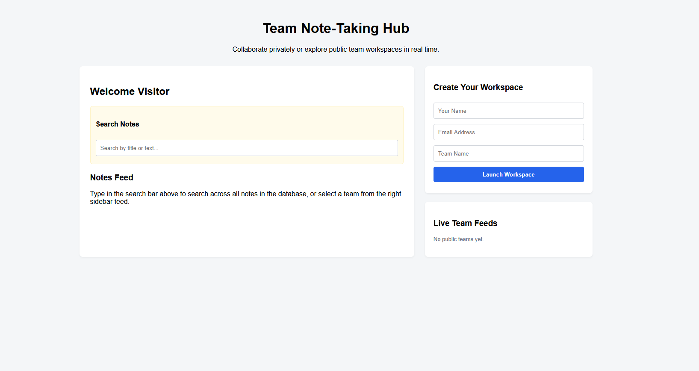
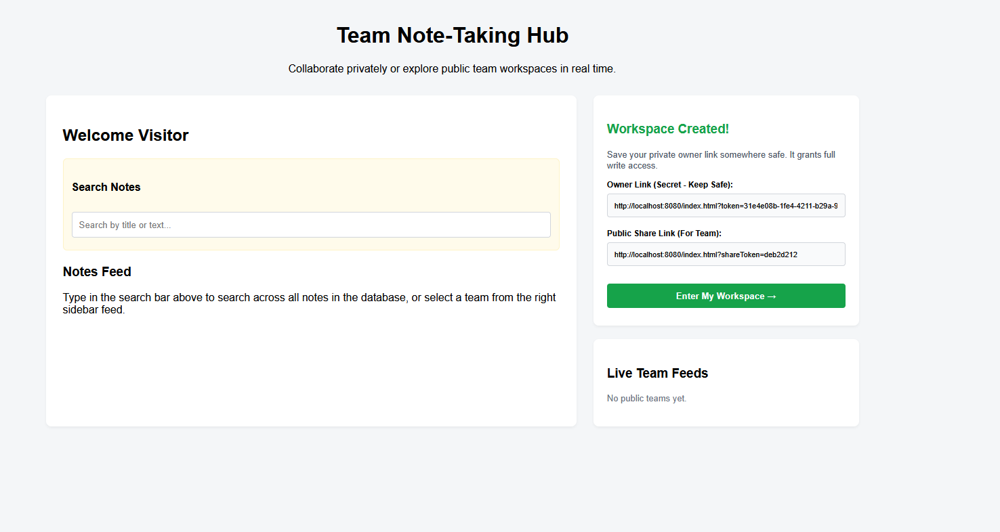
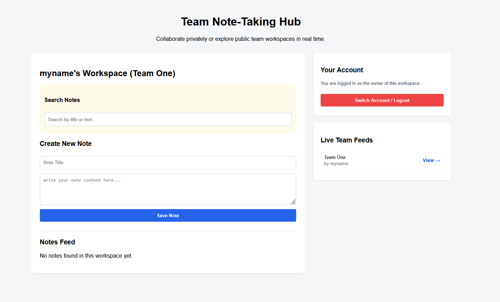
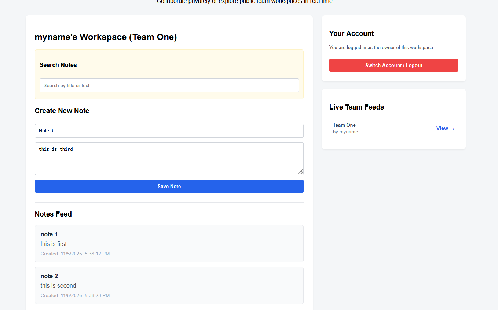
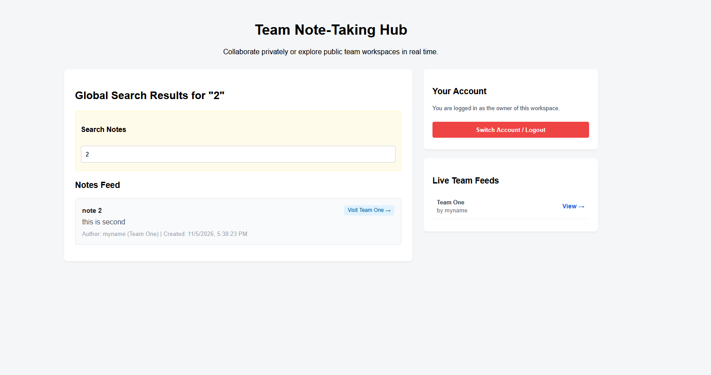
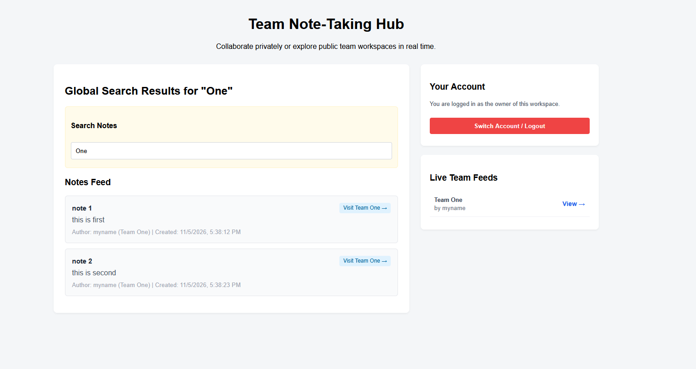

# Team Note-Taking Hub 📝

A responsive, multi-user note-taking platform built with **Spring Boot** and **Neon PostgreSQL**. The application features dual-access permissions (Private Workspace Owners vs. Public Readers), a global search engine spanning all notes and teams, and a live team feed directory.

---

## 📸 Visual Showcase

### 1. Main Dashboard & Public Feed (`main.png`)
The primary landing page view featuring the live directory feed on the right and the search workspace on the left.


### 2. User Creation & Secret Link Generation (`usercreated.png`)
Registration automatically generates secure Owner tokens and truncated public share tokens with one-click selection.


### 3. Personal Workspace View (`userworkspace.png`)
The active private workspace layout allowing owners to create notes and manage their environment.


### 4. Note Creation Action (`creatingnotes.png`)
Adding and saving notes directly into the active user workspace.


### 5. Global Content Search (`searchnotebycontent.png`)
Scouring note text across the entire database to surface relevant results instantly.


### 6. Team Name Search (`searchbyteamname.png`)
Querying team names globally to connect readers with peer workspaces.


---

## 🌟 Key Features

* **Dual-Access Permission Model**:
  * **Owner Mode**: Accessed via a secret full UUID token granting full write and read permissions.
  * **Public Reader Mode**: Accessed via a truncated 8-character SHA-256 hash token derived from the owner's UUID for read-only access.
* **Unified Global Search Engine**: Scours note titles, content, author names, and team names across the entire database simultaneously, complete with direct links to visit matching team workspaces.
* **Session Persistence**: Saves active workspace tokens in `localStorage` for seamless automatic return visits.

---

## 🛠️ Tech Stack

* **Backend**: Java, Spring Boot, Spring Data JPA, Hibernate
* **Database**: Neon PostgreSQL (Serverless Cloud)
* **Frontend**: Vanilla JavaScript, HTML5, CSS3 (Single Page App served via Spring Boot)
* **Build Tool**: Gradle 

---

## 🚀 Running Locally

### 1. Prerequisites
You only need **Java** installed locally. The application connects directly to your cloud-hosted **Neon PostgreSQL** database over SSL.
* **Java Development Kit (JDK) 17+**
* **Git**

### 2. Clone the Repository
```bash
git clone [https://github.com/rajulj-test/note-service.git](https://github.com/rajulj-test/note-service.git)
cd note-service
